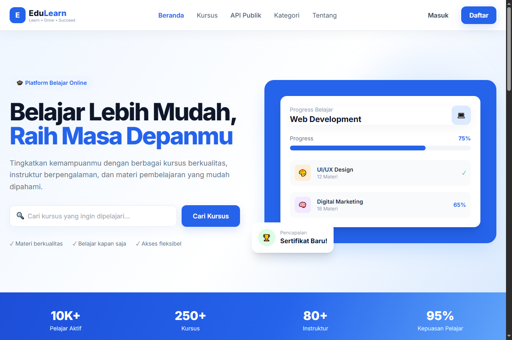
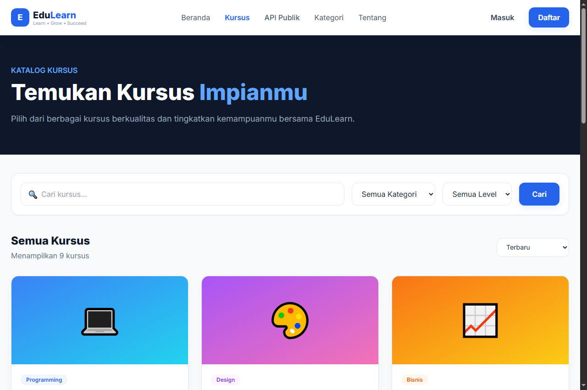
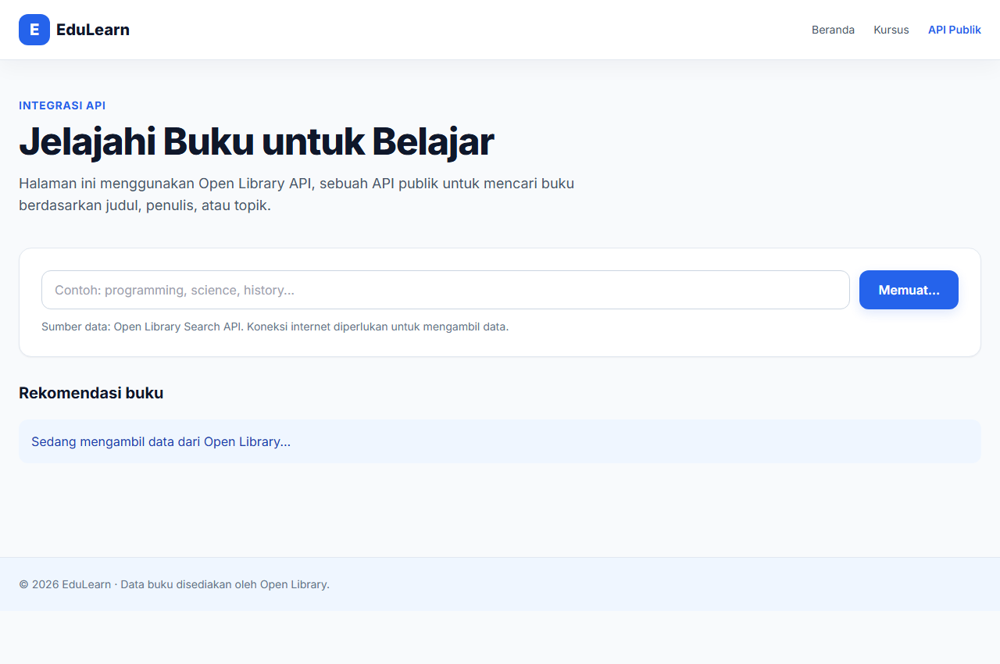
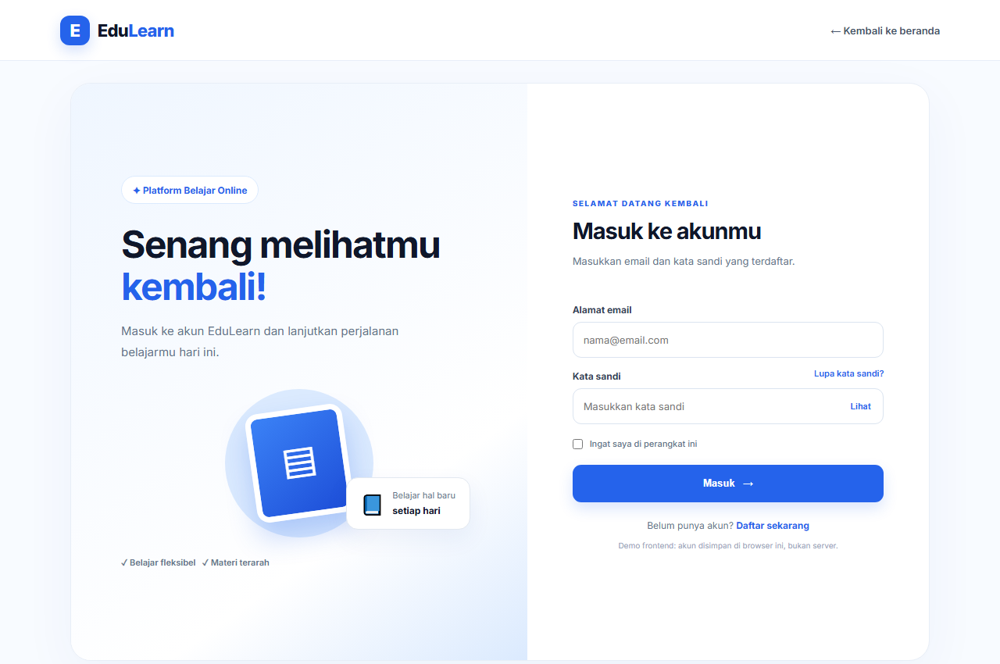
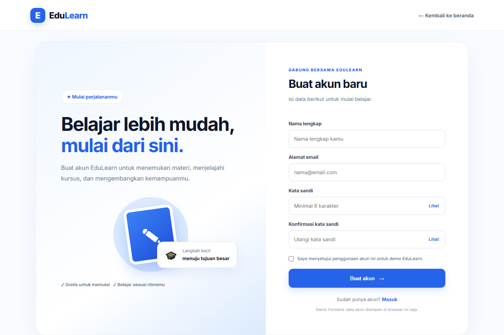

# 🎓 EduLearn - Platform Belajar Online

> Website platform edukasi online modern dengan fitur pencarian dan filter kursus interaktif, sistem autentikasi frontend, serta integrasi API publik Open Library untuk pencarian referensi buku belajar.

---

## 📸 Dokumentasi & Tampilan Website (Screenshots)

Berikut adalah dokumentasi tampilan antarmuka (UI) dari setiap halaman pada website **EduLearn**:

### 1. Halaman Beranda (Landing Page)
Halaman utama yang menampilkan *Hero Section* interaktif, statistik pembelajaran, kategori pilihan, kursus terpopuler, serta pengenalan tentang EduLearn.



---

### 2. Halaman Katalog & Filter Kursus
Halaman daftar kursus yang dilengkapi fitur pencarian kata kunci secara instan, filter kategori (Programming, Design, Bisnis, Digital Marketing), filter tingkat kesulitan, dan fitur pengurutan (*sorting*).



---

### 3. Halaman Integrasi API Publik (Open Library)
Halaman eksplorasi buku belajar yang terintegrasi langsung dengan **Open Library Search API** menggunakan `Fetch API` secara asinkron, lengkap dengan indikator pemuatan (*loading state*) dan kartu hasil pencarian interaktif.



---

### 4. Halaman Masuk (Login)
Halaman autentikasi untuk pengguna yang sudah terdaftar, dilengkapi fitur *toggle show/hide password*, opsi *Remember Me*, dan validasi formulir interaktif berbasis `localStorage`.



---

### 5. Halaman Pendaftaran (Register)
Halaman pembuatan akun baru dengan validasi data masukan, konfirmasi kecocokan kata sandi, persetujuan syarat ketentuan, dan umpan balik pengguna secara *real-time*.



---

## ✨ Fitur-Fitur Utama

- **🎨 Tampilan Modern & Responsif**: Dibangun dengan Tailwind CSS dan tata letak yang ramah untuk perangkat mobile maupun desktop.
- **🔍 Filter & Pencarian Kursus Real-time**: Memungkinkan pengguna mencari kursus berdasarkan nama, kategori keahlian, dan tingkat kesulitan tanpa memuat ulang halaman.
- **📚 Integrasi API Publik Open Library**: Fitur pencarian buku referensi belajar langsung dari server eksternal Open Library secara asinkron (*AJAX / Fetch API*).
- **🔐 Sistem Autentikasi Pengguna (Client-Side)**:
  - Registrasi akun baru dan penyimpanan data lokal menggunakan `localStorage`.
  - Validasi email dan pencocokan kata sandi.
  - Fitur lihat/sembunyikan (*toggle*) kata sandi.
  - Sesi login aktif dan tombol keluar (*logout*).
- **⚡ Navigasi Halus**: Dukungan menu hamburger untuk perangkat seluler (*mobile navigation*).

---

## 🛠️ Teknologi yang Digunakan

| Komponen | Teknologi |
| :--- | :--- |
| **Markup** | HTML5 (Semantik) |
| **Styling** | Tailwind CSS (CDN) & CSS3 Kustom |
| **Tipografi** | Google Fonts (*Inter*) |
| **Interaktivitas** | JavaScript (ES6+) |
| **API Eksternal** | [Open Library Search API](https://openlibrary.org/developers/api) |
| **Penyimpanan Lokal** | Browser Web Storage API (`localStorage`) |

---

## 📁 Struktur Folder Proyek

```text
EduLearn/
│
├── screenshots/             # Dokumentasi gambar tampilan website
│   ├── beranda.png          # Screenshot Halaman Beranda
│   ├── kursus.png           # Screenshot Halaman Kursus & Filter
│   ├── api-publik.png       # Screenshot Halaman Integrasi API Publik
│   ├── login.png            # Screenshot Halaman Login
│   └── register.png         # Screenshot Halaman Registrasi
│
├── src/                     # Source code aplikasi
│   ├── index.html           # Halaman utama / beranda
│   ├── courses.html         # Halaman katalog kursus & filter
│   ├── api.html             # Halaman integrasi API publik
│   ├── login.html           # Halaman login
│   ├── register.html        # Halaman registrasi
│   ├── style.css            # Styling kustom tambahan
│   ├── script.js           # Logika filter kursus dan interaksi navigasi
│   ├── auth.css             # Styling khusus halaman login & register
│   ├── auth.js              # Logika autentikasi dan validasi form
│   ├── api.css              # Styling khusus halaman API
│   └── api.js               # Logika Fetch API ke Open Library
│
├── package.json             # Konfigurasi proyek & skrip lokal
└── README.md                # Dokumentasi utama proyek
```

---

## 🚀 Cara Menjalankan Project

Anda dapat menjalankan project ini dengan beberapa cara mudah:

### Opsi 1: Menggunakan Node.js / NPM (Rekomendasi)
```bash
# Menjalankan local server
npm start
```
Buka browser dan akses alamat yang tertera (biasanya `http://localhost:3000` atau `http://localhost:5000`).

### Opsi 2: Menggunakan Live Server di VS Code
1. Pasang ekstensi **Live Server** di Visual Studio Code.
2. Buka folder proyek ini di VS Code.
3. Klik kanan pada file `src/index.html` lalu pilih **Open with Live Server**.

### Opsi 3: Buka Langsung di Browser
Klik dua kali pada file `src/index.html` untuk langsung membukanya di browser favorit Anda. *(Catatan: Untuk fitur API publik, pastikan perangkat terhubung ke internet)*.

---

## 👩‍💻 Pengembang
- **Repository**: [Dheaayu24/Tugaskelas_Pemweb](https://github.com/Dheaayu24/Tugaskelas_Pemweb.git)
- **Tugas**: Pemrograman Web
